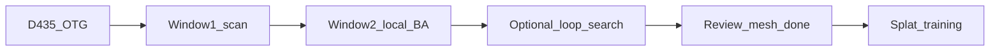

# Сканер пространства под Gaussian Splatting

Телефон снимает Intel RealSense D435 и сам доводит сцену до сплатов. Экспорта в COLMAP нет, обучение на Mac не делаем. Позы считает stella_vslam. Грубая сетка нужна, чтобы оценить съёмку до сплаттинга. Горячие ядра сплаттинга пишем на Slang в SPIR-V.

Съёмка, уточнение поз, настройки и список сканов уже работают. Окно сплаттинга ещё впереди.

## Телефон

Tecno Pova 7 Pro 5G. Чип Dimensity 7300 Ultimate (MT6878): 4× Cortex-A78 @ 2.5 ГГц, 4× A55 @ 2.0 ГГц, Mali-G615 MC2 (Vulkan 1.3). Общей памяти 16 ГБ, этого хватает, чтобы держать гауссианы и состояния Adam, а кадры поднимать по одному. Накопитель UFS 2.2, батарея 6000 мА·ч.

Трекинг уже держит порядка 10 fps на 640×480. Ниже 5 fps не уходим. Обход — комната и возврат в уже снятую точку.

## Захват D435

Порт USB Type-C 2.0, только прямой OTG. USB 3 на этом аппарате нет. У этого экземпляра D435 нет MJPEG, рабочий профиль — color YUYV и depth Z16, 640×480 @ 30. Глубина метрическая, масштаб в BA не отпускаем. IMU телефона не используем: камера на кабеле не сидит в его системе координат. GPL (ORB-SLAM3, OpenVINS, VINS-Fusion) не линкуем. RTAB-Map, GLIM и DROID-SLAM в APK не тащим.

## Окна

Каждое окно — своя Activity. Устройство Vulkan и объём сетки переживают смену окна: поверхность только перепривязывается. Съёмка и уточнение поз сменяют друг друга сдвигом по горизонтали. Настройки и список сканов выезжают снизу.

Строка состояния лежит сверху, кнопки снизу, кадр камеры между ними. Кнопка меню слева, ящик открывается слева. Пока в сетке есть недорисованные чанки или очередь операций, под строкой состояния виден процент и маленький круговой индикатор.

### Съёмка

Start scanning и Stop. До Start камера показывает превью, ключевые кадры и сетка не пишутся. После Start на месте кнопки — Stop. Stop замораживает набор и открывает уточнение поз. Повторный Start на уже снятой сессии сначала спрашивает, потому что стирает кадры. Reset гасит stella и сетку и возвращает на это окно.

В ящике: Settings, Scans, Record. Запись отладочного набора включается сразу и трекинг не перезапускает.

Полный кадр текущего профиля пишется на диск отдельным потоком, чтобы не занимать поток трекинга и не держать YUYV+Z16 в куче. Очередь записи короткая: если она заполнена, этот полный кадр пропускается. Для сетки в памяти остаётся уменьшенная копия. Картинки ключевых кадров stella по-прежнему ограничены примерно 96 МБ; при переполнении старейший кадр запекается, сетка остаётся.

### Уточнение поз

Отдельный оптимизатор не пишем. После Stop очередь маппинга доигрывается, и локальный BA stella проходит без прерывания. Во время съёмки он часто не доходит до конца: очередь больше 2 — пропуск, новый ключевой кадр обрывает уже начатый.

Затем необязательный поиск замыканий. Возврат в уже снятую точку без петли оставляет две сетки рядом, и локальный BA этот дрейф не убирает. Поиск включён по умолчанию. Кандидаты берёт `loop_detector` stella: словарь, затем геометрическая проверка. В граф попадает только пара, у которой сошлась геометрия. Если ни одна петля не принята, pose graph не запускается. Принятые петли идут в `graph_optimizer` и следом в глобальный BA. Петли, найденные ещё во время съёмки, не выкидываем.

Сетка строится заново после этого шага, вокселем просмотра. По умолчанию 2 см, в настройках ещё 4 и 8. Воксель съёмки остаётся своим, по умолчанию 8 см. Прогресс стоит в центре экрана: очередь, локальный BA, петли, сетка. Просмотр только сетки.

Камера одна. Трекбол внизу везёт взгляд вперёд, светло-серый, точка нажатия синяя. Палец по остальному экрану поворачивает взгляд, два пальца задают крен. Крен по умолчанию нулевой. Кнопка First frame ставит вид на первый ключевой кадр. Подписи про перетаскивание нет.

Назад закрывает ящик, если он открыт, иначе возвращает к съёмке. Кадры при этом остаются, и сетка снова собирается вокселем съёмки. В ящике этого окна: Settings и Scans. Start splatting включается, когда меш этого окна досчитан. С этого момента второе окно закрыто, и вернуться на него нельзя.

Save спрашивает место и имя файла через системный выбор документа. Листа «Поделиться» нет. Пока архив пишется, экран закрыт круговым индикатором, и остальные кнопки вместе с кнопкой назад не действуют.

### Настройки

Отдельное окно, три раздела.

Tracking: профиль камеры, воксель 2/4/8 см (по умолчанию 8), интеграция 80/160/320 (по умолчанию 160), число особенностей, уровни пирамиды, дальность глубины, кромка неснятого объёма, Apply и Reset. Apply и Reset перезапускают stella и очищают сетку, поток камеры остаётся. Кромка применяется сразу.

Pose refinement: Close loops (по умолчанию включён) и воксель просмотра 2/4/8 см (по умолчанию 2). Оба применяются сразу и трекинг не перезапускают. Если просмотр уже открыт, смена вокселя пересобирает сетку.

Splatting: validation, его доля и число эпох. Поля описаны в [splatting.md](splatting.md) и применяются к следующему рану.

### Сохранённые сканы

Окно открывается из ящика съёмки и из ящика уточнения поз. Сканы — список широких строк. Нажатие выделяет строку, пустое место снимает выделение. Open внизу активен только при выделении и сразу загружает скан в окно уточнения поз: без нового BA и без сплаттинга. Если съёмка уже идёт, загрузка сначала спрашивает замену. Кнопка меню слева: Remove активен при выделении и удаляет этот скан, Remove all очищает список.

### Пакет .pscan

Один zip. Цвет и глубина — полное разрешение текущего профиля камеры. Сетка по-прежнему интегрирует уменьшенную копию.

`manifest.json`: format `pocket-scan`, version 1, время UTC, `voxelCm`, `reviewVoxelCm`, `depthScale`. Метры глубины — сырой Z16, делённый на `depthScale`. На каждый кадр: id, ширина, высота, fx, fy, cx, cy полного кадра и поза из 16 чисел по строкам, камера в мир. Цвет — `frames/{id}.png`, глубина — `frames/{id}.z16`, uint16 LE как отдала камера, сжатие даёт сам zip. Синтетические кадры покрытия в пакет не входят. Позже в тот же архив можно добавить каталог `splat/` и поднять version, кадры при этом не меняются.

### Сплаттинг

Обучение начинается с досчитанного меша второго окна: сплат на вершину, затем эпохи train и validation. Видео траектории снимается без билатеральной сетки. Реализация расписана в [splatting.md](splatting.md).

## Слои

- `android/app` — Kotlin, Compose: съёмка, уточнение поз, настройки, список сканов, USB и превью.
- Нативный код рядом: stella для поз, Vulkan для сетки и потом для сплатов. Шейдеры сетки уже в SPIR-V 1.3. Сплаттинг — `slangc -target spirv`, компилятор в APK не кладём.

Грубая сетка описана в [mesh.md](mesh.md). Она не участвует в трекинге. Обучение сплаттов описано в [splatting.md](splatting.md).

## Окружение

Всё для сборки лежит в `/home/alex/dev`. Подключение: `source scripts/env.sh`.

- `/home/alex/dev/android-sdk` — platform android-35, NDK 28.2.13676358. Сборка нативного кода `-j2`.
- `/home/alex/dev/slang` — `slangc`.
- `/home/alex/dev/librealsense` — v2.59.1. Модуль librealsense не меняем: его `abiFilters` и `ndkVersion` остаются как есть.
- `/home/alex/dev/stella_vslam` — 0.7.0. Свой SLAM не начинаем, stella не пересобираем без отдельной просьбы.

## Порядок

1. Окно съёмки, настройки и грубая сетка — сделано.
2. Окно поз: локальный BA, необязательные петли, сетка просмотра и одна камера — сделано.
3. Пакет `.pscan`, выбор места сохранения и окно списка сканов с загрузкой сразу во второе окно — сделано.
4. Обучение сплаттов по [splatting.md](splatting.md): посев с меша второго окна, эпохи, видео без билатеральной сетки.
