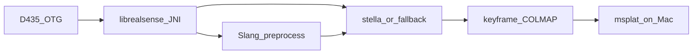

# Сканер пространства под Gaussian Splatting

Телефон — Tecno Pova 7 Pro (Dimensity 7300 Ultimate, USB Type-C 2.0). Он снимает Intel RealSense D435, на устройстве считает позы и отдаёт датасет COLMAP из ключевых кадров. Обучение сплатов — отдельный этап в msplat на Mac. Если stella_vslam на этом телефоне не держит частоту, заменяем её своим RGB-D пайплайном. Горячие места после профайла переносим на Mali через Slang.

## Телефон

Tecno Pova 7 Pro 5G. Чип Dimensity 7300 Ultimate (MT6878): 4× Cortex-A78 @ 2.5 ГГц, 4× A55 @ 2.0 ГГц, Mali-G615 MC2 (~0.5 TFLOP, Vulkan 1.3), LPDDR5. В линейке 8 или 12 ГБ физической RAM, накопитель UFS 2.2, батарея 6000 мА·ч. Расширение RAM средствами HiOS в бюджет SLAM не считаем. Geekbench около 1000 / 2800. По одному ядру это сосед Galaxy S20, на котором наивный OpenVSLAM показывал порядка 2 fps.

Рабочая цель трекинга: устойчивые 8–12 fps на 640×480 несколько минут, без просадки ниже 5 fps от троттлинга. 15 fps — удачный потолок после переноса горячего ядра на GPU, не стартовое обещание. Обход — несколько комнат. Тысячи ключевых кадров на 8 ГБ уже тесно, субкарты оставляем в конструкции.

Mali-G615 MC2 — два ядра. На нём окупается сплавленное ядро по пикселям (пирамида, выравнивание, даунсэмпл глубины). Разреженный граф, PnP и BoW остаются на CPU: на такой ширине GPU они не быстрее, а шина памяти узкая (~25 ГБ/с).

## Захват D435

Приложения Intel RealSense Camera / RS Camera в Play Store больше нет. Последний официальный билд — `com.intel.realsense.camera` 2.50.0.3697 от декабря 2021 (librealsense 2.50). Сторонние APK-зеркала не используем.

Проверку USB и потоков делаем своим тестовым приложением из [wrappers/android](https://github.com/realsenseai/librealsense/tree/master/wrappers/android) в librealsense (Apache 2.0): превью depth и color, в UI строка USB descriptor и фактические разрешение/fps, кнопка записи. Рут не нужен, калибровку и прошивку камеры с телефона не делаем.

У Pova 7 Pro порт — USB Type-C 2.0, OTG ([GSMArena](https://www.gsmarena.com/tecno_pova_7_pro_5g-13990.php)). USB 3 на этом аппарате нет, полный поток 848×480 @ 30 плюс цвет не влезет. Режим захвата:

- color MJPEG, не YUYV;
- старт с depth 640×480 @ 15 и color 640×480 @ 15;
- 848×480 depth только если дескриптор и стабильность на 15 fps это позволят, иначе 480×270 @ 30.

В тестовом приложении всё равно показываем USB descriptor: если конкретный экземпляр вдруг перечислится как 3.x, поднимем профиль, но код и SLAM рассчитываем на 15 fps и 640×480.

Питание. Спецификация USB 2 ограничивает устройство 500 мА, при этом у Pova 7 Pro заявлена проводная реверсивная зарядка 10 Вт, так что OTG-ток может быть выше паспортного минимума. D435 на слабом VBUS всё равно часто отваливается. Если на прямом кабеле камера моргает, сразу ставим запитанный OTG-хаб.

## Ключевые кадры

Поток целиком на диск не пишем и в обучение не отдаём. SLAM читает кадры, промежуточные выбрасывает.

Ключевой кадр — когда с прошлого сработало смещение или поворот (старт: около 8 см или 8°) и кадр резкий. Эти пороги плотнее, чем минимум для «чтобы трекинг не умер»: редкие SLAM-кадры дают дыры в сплате. Порог крутим по первой комнате.

Узлы pose graph и финальный pose-only BA — те же ключевые кадры. После «стоп» граф дожимается на них, без интерполяции промежуточных поз. Экспорт COLMAP: JPEG ключевых кадров, интринсики RealSense (`PINHOLE` или `OPENCV`), кватернион и `t` в world-to-camera. Глубину ключевого кадра можно положить рядом; msplat её в лосс не берёт.

Комната — сотни кадров, этаж — одна-две тысячи. Это и есть объём обучения.

## SLAM

Порядок жёсткий.

1. Спайк stella_vslam, RGB-D, на этом телефоне. Версия не ниже 0.3. Зависимости: OpenCV, Eigen, g2o, FBoW, yaml-cpp. Трекинг на уменьшенной копии (640×480 или ниже, 500–800 ORB). Loop closure и глобальный BA — отдельный поток, не в колбэке камеры.
2. Критерий «оставляем stella»: не меньше 8 fps трекинга пять минут подряд, петля по комнате подтягивает траекторию, закрытие петли не останавливает трекинг.
3. Если критерий не взят — свой RGB-D пайплайн на том же интерфейсе `track / loop / optimize / export`:
   - трекинг: point-to-plane ICP через small_gicp (MIT, OpenMP) по даунсэмплу глубины и ORB (OpenCV, Apache 2.0) на цвете;
   - петли: FBoW (MIT), проверка PnP с глубиной;
   - граф: GTSAM (BSD), iSAM2, pose-only BA по ключевым кадрам в конце сессии;
   - субкарты примерно по 50 ключевых кадров.
4. DROID-SLAM на этом SoC не запускаем. Его realtime у авторов — две RTX 3090 и от 11 ГБ видеопамяти. ncnn снимет только свёртку, плотный BA по correlation volume на Mali не помещается. Slang не переводит готовый CUDA сам.

D435 без IMU достаточен при спокойном ходе и геометрии в кадре. D435i с заводским IMU остаётся желательным апгрейдом (факторы преинтеграции в том же графе). IMU телефона не используем: камера на кабеле не сидит в его системе координат.

GPL (ORB-SLAM3, OpenVINS, VINS-Fusion) не линкуем. RTAB-Map и GLIM в APK не тащим.

## Slang на Mali

Компиляция офлайн: `slangc -target spirv -profile spirv_1_5`, SPIR-V в assets. В APK компилятор Slang не кладём. Vulkan 1.3 на этом GPU есть.

Грубая сетка покрытия, которую телефон рисует поверх превью, описана в [mesh.md](mesh.md). Она не участвует в трекинге. Шейдеры сетки собраны в SPIR-V 1.3: обвязка устройства объявлена как Vulkan 1.1.

Сначала simpleperf на спайке stella, потом на GPU уезжает то, что реально ест время. Кандидаты по убыванию пользы:

- серое изображение, undistort и пирамида;
- FAST/ORB, если это больше примерно 40% трекинга;
- даунсэмпл и нормали глубины, если уйдём в свой ICP.

g2o и поиск по словарю на GPU не переносим. Ядра пишем заново под лимиты Mali (shared memory, размер рабочей группы), держим данные на GPU между проходами.

Отдельный прямой растеризатор сплата (проекция, тайлы 16×16, сортировка, композитинг, без backward и Adam) делаем после того, как ключевые кадры уже обучаются в msplat. На MC2 смотреть придётся урезанный ply. Тот же Slang позже собирается в Metal.

Обучение остаётся на Mac с msplat. На этой Linux-машине msplat не запускается (нужен Apple Silicon). Пока Мака нет, тот же COLMAP читает gsplat.

## Слои

- `core/` — C++: сессия, ключевые кадры, обёртка SLAM, экспорт COLMAP. JNI сейчас, XCFramework когда дойдёт до iOS.
- `android/` — Kotlin, Jetpack Compose: USB permission, превью, кнопки старт/стоп.

Kotlin на iOS сам не собирается. RealSense на iPhone не планируется. Позже ARKit и LiDAR садятся на тот же граф и тот же экспорт.

## Окружение

Всё для спайка лежит в `/home/alex/dev`. GTSAM и small_gicp не ставим, пока не уйдём в свой пайплайн. CUDA Toolkit не нужен.

- `/home/alex/dev/android-sdk` — cmdline-tools, platform android-35, build-tools 35.0.1, platform-tools (adb 37.0.1), NDK 28.2.13676358, CMake 3.31.6. `ANDROID_HOME` сюда. Подключение: `source scripts/env.sh`.
- `/home/alex/dev/android-studio` — Android Studio Rabbit 2 Patch 1 (2026.2.2.9).
- `/home/alex/dev/slang` — `slangc` 2026.20 (`bin/slangc`).
- `/home/alex/dev/librealsense` — v2.59.1, `realsenseai/librealsense`.
- `/home/alex/dev/stella_vslam` — свежий master, FBoW уже сабмодулем.
- Рядом исходники для кросс-сборки спайка: `/home/alex/dev/opencv` 4.12.0, `/home/alex/dev/eigen` 3.4.0, `/home/alex/dev/g2o` 20241228, `/home/alex/dev/yaml-cpp` 0.8.0. Под NDK их ещё не собирали.

JDK на машине: OpenJDK 21.

## Тестовое приложение

Каталог `android/`. Отдельный Gradle-проект, не форк `tools/camera`. Библиотеку берём модулем из уже склонированного дерева:

`project(':librealsense').projectDir = /home/alex/dev/librealsense/wrappers/android/librealsense`

JFrog-координату `com.intel.realsense:librealsense` не используем. Сборка только `arm64-v8a` (в модуле ещё включён `x86_64`, его не трогаем). AGP 8.9.1 и Kotlin 2.0.21, как в обёртке librealsense. compileSdk/targetSdk 35, minSdk 24.

Один экран, Kotlin. Превью — `GLRsSurfaceView` внутри Compose `AndroidView`: у librealsense кадр заливается в этот view, свой GL не пишем.

Поведение:

- `RsContext.init` и разрешение CAMERA. USB-разрешение запрашивает сама библиотека (`UsbUtilities`, VID `0x8086`).
- Старт пайплайна: depth `640×480` `Z16` @ 15 и color `640×480` `MJPEG` @ 15. Если профиль не открылся, вторая попытка — depth `480×270` @ 30 и color `640×480` MJPEG @ 15. Ошибка профиля пишется на экран.
- Строка статуса из `Device.getInfo`: имя, прошивка и `CameraInfo.USB_TYPE_DESCRIPTOR`. Рядом фактические ширина, высота и fps за последнюю секунду. Счётчик отвалов устройства.
- Кнопка «Снять кадр» пишет один кадр, не поток: байты MJPEG как JPEG и сырой Z16 того же `FrameSet`, плюс текстовый сайдкар. Каталог — `Android/media/<applicationId>/captures/`.
- Поз в этом приложении нет. Порог 8 см / 8° появится вместе со SLAM.

Проверка: `adb devices` и debug-сборка. С D435 на OTG смотрим дескриптор, оба стрима и сохранённый кадр. Десять минут без отвала — прогон на телефоне.

## Порядок

1. Этот документ.
2. Тулчейн в `/home/alex/dev`.
3. Тестовое приложение захвата, как в разделе выше.
4. Спайк stella_vslam и решение по критерию выше.
5. Профайл и Slang-ядра по горячим местам, если stella остаётся. Иначе свой пайплайн, и те же ядра препроцессинга.
6. Экспорт COLMAP и проверка, что тренер открывает датасет.
7. Просмотр ply.
