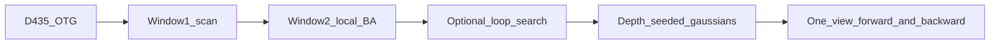

# Сканер пространства под Gaussian Splatting

Телефон снимает Intel RealSense D435 и сам доводит сцену до сплатов. Экспорта в COLMAP нет, обучение на Mac не делаем. Позы считает stella_vslam. Грубая сетка нужна, чтобы оценить съёмку до сплаттинга. Горячие ядра сплаттинга пишем на Slang в SPIR-V.

## Телефон

Tecno Pova 7 Pro 5G. Чип Dimensity 7300 Ultimate (MT6878): 4× Cortex-A78 @ 2.5 ГГц, 4× A55 @ 2.0 ГГц, Mali-G615 MC2 (Vulkan 1.3). Общей памяти 16 ГБ, этого хватает, чтобы держать гауссианы и состояния Adam, а кадры поднимать по одному. Накопитель UFS 2.2, батарея 6000 мА·ч.

Трекинг уже держит порядка 10 fps на 640×480. Ниже 5 fps не уходим. Обход — комната и возврат в уже снятую точку.

## Захват D435

Порт USB Type-C 2.0, только прямой OTG. USB 3 на этом аппарате нет. У этого экземпляра D435 нет MJPEG, рабочий профиль — color YUYV и depth Z16, 640×480 @ 30. Глубина метрическая, масштаб в BA не отпускаем. IMU телефона не используем: камера на кабеле не сидит в его системе координат. GPL (ORB-SLAM3, OpenVINS, VINS-Fusion) не линкуем. RTAB-Map, GLIM и DROID-SLAM в APK не тащим.

## Три окна

### Съёмка

Start scanning и Stop. Place marker и Save frame убираем. Reset гасит stella и сетку и возвращает на это окно. До Start камера показывает превью, ключевые кадры и сетка не пишутся. Stop замораживает набор и открывает следующее окно. Повторный Start на уже снятой сессии сначала спрашивает, потому что стирает кадры.

На Stop цвет и глубина ключевых кадров пишутся на диск. В памяти плотные кадры живут около 96 МБ и при переполнении выбрасываются, сетка при этом остаётся. Для сплаттинга нужны картинки, и подгружать их будем по одному кадру.

### Уточнение поз

Отдельный оптимизатор не пишем. После Stop камера остановлена, очередь маппинга пустая, и локальный BA stella доигрывается без прерывания. Во время съёмки он часто не доходит до конца: очередь больше 2 — пропуск, новый ключевой кадр обрывает уже начатый.

Затем необязательный поиск замыканий. Возврат в уже снятую точку без петли оставляет две сетки рядом, и локальный BA этот дрейф не убирает. Поиск включён по умолчанию и выключается одним переключателем. Кандидаты берёт `loop_detector` stella: словарь, затем геометрическая проверка. В граф попадает только пара, у которой сошлась геометрия. Если ни одна петля не принята, pose graph не запускается. Принятые петли идут в `graph_optimizer` и следом в глобальный BA. Петли, найденные ещё во время съёмки, не выкидываем.

Сетка строится заново после этого шага. Прогресс: очередь, локальный BA, петли (пропуск, если выключено), сетка. Просмотр только сетки. Левый трекбол двигает точку обзора, правый крутит её. Назад возвращает к съёмке и кадры не удаляет. Start splatting — только если кадры лежат на диске.

### Сплаттинг

Глубина D435 — плотный приор. MVS не строим. Гауссианы сеются как тонкие диски на поверхности: нормаль по соседям, малый масштаб вдоль нормали, цвет из кадра. Это схема тёплого старта из PocketGS (arXiv 2601.17354). Их Metal-код и лимит в 500 шагов не берём.

Перед обучением буфер сетки отпускаем, это около 1 ГБ на 8000 чанков. На шаг в память поднимается один вид, считается прямой проход и backward, след этого вида удаляется до следующего кадра. Параметры гауссиан и Adam остаются в памяти.

Растеризация — свой код по алгоритму [vk_gaussian_splatting](https://github.com/nvpro-samples/vk_gaussian_splatting) (Apache 2.0): проекция в тайлы 16×16, поразрядная сортировка по глубине, смешивание спереди назад. Репозиторий — просмотрщик, не тренер, и он хочет Vulkan 1.4. На Mali его не линкуем, трассировку лучей не берём. Backward пишем сами в Slang. Сколько шагов выдержит GPU, заранее не фиксируем. Уплотнение включаем, если шаг по времени остаётся приемлемым. Просмотр в том же окне теми же двумя трекболами.

## Слои

- `android/app` — Kotlin, Compose: три окна, USB, превью.
- Нативный код рядом: stella для поз, Vulkan для сетки и потом для сплатов. Шейдеры сетки уже в SPIR-V 1.3. Сплаттинг — `slangc -target spirv`, компилятор в APK не кладём.

Грубая сетка описана в [mesh.md](mesh.md). Она не участвует в трекинге.

## Окружение

Всё для сборки лежит в `/home/alex/dev`. Подключение: `source scripts/env.sh`.

- `/home/alex/dev/android-sdk` — platform android-35, NDK 28.2.13676358. Сборка нативного кода `-j2`.
- `/home/alex/dev/slang` — `slangc`.
- `/home/alex/dev/librealsense` — v2.59.1. Модуль librealsense не меняем: его `abiFilters` и `ndkVersion` остаются как есть.
- `/home/alex/dev/stella_vslam` — 0.7.0. Свой SLAM не начинаем, stella не пересобираем без отдельной просьбы.

## Порядок

1. Окно съёмки: Start, Stop, сохранение кадров.
2. Окно поз: локальный BA, необязательные петли, сетка и трекболы.
3. Окно сплаттинга: посев из глубины, растеризация, backward одного вида.
