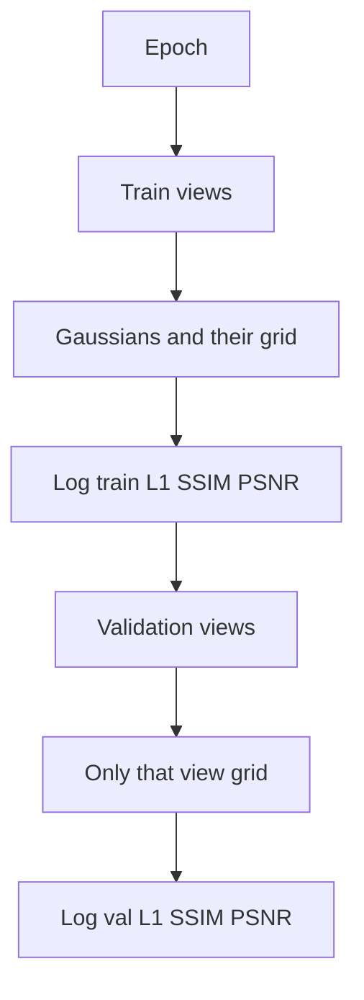
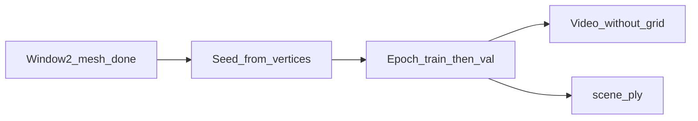

# Сплаттинг

Телефон обучает гауссианы после того, как меш второго окна досчитан. Меш описан в [mesh.md](mesh.md), здесь он только источник начальных сплатов. Растеризация, билатеральная сетка и SSIM пишутся на Slang и собираются в SPIR-V 1.3 на этапе сборки. Компилятор в APK не кладём. CUDA-реализации не линкуем и не копируем: они задают формулы.

Опора по сетке — `BilateralGrid` и `slice` из [fused-bilagrid](/home/alex/dev/fused-bilagrid), статья [Bilateral Guided Radiance Field Processing](https://bilarfpro.github.io/). Опора по SSIM — [fused-ssim](/home/alex/dev/fused-ssim): ядро 11×11, раздельная свёртка, константы `C1 = 0.01²`, `C2 = 0.03²`. Растеризация повторяет алгоритм [vk_gaussian_splatting](https://github.com/nvpro-samples/vk_gaussian_splatting) (Apache 2.0): тайлы 16×16, поразрядная сортировка по глубине, смешивание спереди назад. Тот репозиторий — просмотрщик под Vulkan 1.4. На Mali его не линкуем, трассировку лучей не берём. Обратный проход одного вида пишем сами.

На шаг в память поднимается один кадр. Параметры гауссиан, их состояния Adam и билатеральные сетки остаются на всё обучение. Полный кадр читается с диска и отпускается до следующего.

## Когда включается обучение

Кнопка Start splatting стоит на втором окне. Она выключена, пока у объёма есть недорисованный чанк или в очереди ещё есть операция. Это тот же признак, по которому на окне виден процент сетки. Отдельный пересчёт меша перед сплаттингом не запускаем: дочитывается тот меш, который уже строится вокселем просмотра. Когда очередь пуста, кнопка включается. Кадры к этому моменту уже лежат на диске.

Нажатие открывает окно обучения и начинает ран. Второе окно при этом закрывается. Вернуться на него нельзя: сессия съёмки уже разобрана.

## Посев с меша

Берутся вершины досчитанного меша. Вершина marching cubes уже несёт положение и цвет поверхности. Нормаль — среднее нормалей треугольников, которым она принадлежит. Вершины янтарной кромки неснятого объёма в посев не входят: у них нет измеренной поверхности.

Каждая оставшаяся вершина становится одним гауссианом.

- Центр — положение вершины.
- Цвет — цвет вершины, одна тройка RGB, без старших гармоник.
- Поворот ставит локальную ось Z вдоль нормали.
- Масштаб в касательной плоскости равен ребру вокселя просмотра. Вдоль нормали он в десять раз меньше: диск лежит на поверхности.
- Непрозрачность на старте 0.5.

Когда гауссианы записаны, удаляется всё, что эпохам не нужно. Уходит объём меша, около 1 ГБ на 8000 чанков. Останавливаются и освобождаются stella, камера и уменьшенные снимки в памяти. С диска рабочих кадров снимается глубина. Цвет, поза и внутренние параметры кадра остаются: их читает каждая эпоха. Сохранённый пользователем пакет `.pscan` не трогаем.

## Растеризация одного вида

Прямой проход проецирует гауссианы в кадр текущего размера, раскладывает их по тайлам 16×16, сортирует по глубине и смешивает спереди назад. Обратный проход того же вида возвращает градиент в центр, масштаб, поворот, непрозрачность и цвет. Списки тайла и отсортированный порядок живут только на время этого кадра и удаляются до следующего. Трекинга к этому моменту уже нет: его память отдана под гауссианы.

## Билатеральная сетка

У каждого кадра, включая validation, своя сетка. Форма одной сетки — `(12, L, H, W)`. По умолчанию яркость-guidance `L = 8`, высота `H = 16`, ширина `W = 16`. Двенадцать чисел клетки — аффинное преобразование 3×4. На старте в каждой клетке лежит единичная матрица: цвет проходит сетку без изменения.

Срез берёт координату пикселя `xy` в диапазоне `[0, 1]` и яркость уже отрендеренного цвета `0.299R + 0.587G + 0.114B`. По этим трём координатам из сетки трилинейно выбирается 3×4, и цвет пикселя становится `rgb' = M rgb + t`. Шаг обучения трогает только сетку текущего кадра.

К потере кадра добавляется total variation активной сетки: средний модуль разности соседних клеток по каждой из трёх осей. Вес члена малый, чтобы сетка убирала сдвиг экспозиции и не запоминала сам кадр. Чужие сетки в этот член не входят.

На кадре из train градиент среза идёт и в коэффициенты сетки, и обратно в отрендеренный цвет, то есть в гауссианы. На кадре из validation градиент обрывается на сетке и в растеризатор не проходит.

## SSIM

Прямой проход считает карту SSIM между исправленным рендером и цветом кадра. Окно 11×11, ядро Гаусса разделяемое и симметричное, поэтому свёртка идёт двумя проходами и промежуточные суммы не пишутся в глобальную память. Веса ядра фиксированы:

`0.00102838, 0.00759876, 0.03600077, 0.10936069, 0.21300553, 0.26601171` и далее симметрично.

За краем кадра пиксель читается как ноль. Каналы считаются отдельно. Значение потери — среднее карты, `C1 = 0.01²`, `C2 = 0.03²`.

Для метрики достаточно прямого прохода. Для обучения обратный проход свёртывает пришедший градиент тем же ядром. Частные производные карты по среднему, по дисперсии первого изображения и по ковариации хранятся на время кадра и удаляются вместе с ним.

L1 — среднее модулей разности по пикселям и каналам. Потеря кадра:

`L1 + 0.2 * (1 - SSIM) + λ * TV`

по цвету после билатеральной сетки. PSNR в лог пишется отдельно и в потерю не входит: `10 * log10(1 / MSE)` при цвете в `[0, 1]`.

Adam ведётся отдельно для параметров гауссиан и для коэффициентов сеток. Стартовые шаги: центр `1.6e-4`, логарифм масштаба `5e-3`, поворот `1e-3`, логит непрозрачности `5e-2`, цвет `2.5e-3`, коэффициенты сетки `2e-3`. Моменты `β1 = 0.9`, `β2 = 0.999`. Эти шаги записываются в папку рана, чтобы следующий запуск можно было отличить от предыдущего.

## Эпоха

Кадры делятся один раз в начале рана. Validation по умолчанию выключен. Когда он включён, доля берётся из настроек, допустимы 5, 8 и 10 процентов, по умолчанию 5. Кадры сортируются по id. В validation попадают те, чей номер в этом порядке кратен `round(100 / процент)`. Для 5 процентов шаг равен 20. Повтор того же пакета даёт тот же набор. Остальные кадры — train. При выключенном validation проход validation пропускается, и все кадры идут в train.

Кадр validation не обновляет гауссианы. Сетка этого кадра обновляется.

Проход train идёт по своим кадрам в порядке id. На кадр: прочитать цвет с диска, отрендерить гауссианы, срезать сетку этого кадра, посчитать потерю по исправленному цвету, сделать шаг Adam в гауссианы и в эту сетку. L1, SSIM и PSNR берутся с того исправленного кадра, который вошёл в потерю, до шага. В конце прохода три числа усредняются по кадрам и пишутся как train.

Затем проход validation. Гауссианы заморожены. На кадр: отрендерить, срезать его сетку, сделать шаг Adam только в эту сетку, срезать сетку ещё раз уже новыми коэффициентами. Метрики пишутся со второго среза. В конце прохода среднее по validation-кадрам пишется отдельной строкой. Картинка второго среза сохраняется и позже показывается в окне метрик.

## Окна

Обучение — отдельная Activity. На ней видны графики L1, SSIM и PSNR текущей эпохи по мере прохода, номер эпохи и полоса прогресса внутри эпохи: сколько кадров прохода уже посчитано и какой это проход, train или validation. На этих графиках можно выбрать один другой готовый ран для сравнения. Его кривые рисуются другим цветом, кривые идущего рана остаются своими. Train и validation одного рана отличаются типом линии. Выбор этого рана снимается повторным нажатием. Пока ран идёт, из этого окна нельзя вернуться к съёмке. Кнопка назад ничего не делает. Второго окна уже нет, и открыть его снова нельзя. Свернуть приложение можно: обучение продолжается, а в шторке висит уведомление с номером эпохи и полосой прогресса этой эпохи. Нажатие на уведомление возвращает в окно обучения. Когда ран кончается, уведомление снимается. Кнопка Stop заканчивает ран досрочно: в папку пишутся метрики и PLY на текущих гауссианах, видео при досрочной остановке не снимается. После Stop и после последней эпохи окно обучения закрывается, и пользователь оказывается на первом окне.

Метрики — другая Activity. Во время рана она открывается поверх обучения, и назад с неё возвращает на обучение, не останавливая ран. Готовые раны открываются из ящика первого окна. В списке отмечается несколько ранов. На одних осях лежат три графика, L1, SSIM и PSNR. У каждого рана две серии, train и validation. Жест двумя пальцами растягивает или сжимает обе оси, перетаскивание вдоль оси сжимает только её, перетаскивание по полю двигает видимый диапазон. График открывается на весь экран и закрывается тем же жестом назад. Рядом показывается рендер validation-кадров выбранного рана: это кадр после билатеральной сетки, по которому посчитана метрика validation. Тут же номер эпохи и полоса прогресса эпохи. Пока ран идёт, окно читает его лог и обновляет кривые и кадры.

Графики рисуются в Compose на телефоне.

## Настройки

Раздел Splatting в окне настроек получает три поля. Переключатель validation, по умолчанию выключен. Доля validation: 5, 8 или 10 процентов, по умолчанию 8, поле доступно при включённом переключателе. Число эпох, по умолчанию 100. Ран идёт ровно столько эпох и сам на этом останавливается: пишет видео и PLY и закрывает обучение. Поля применяются к следующему рану и уже идущий не переписывают. Трекинг они не перезапускают.

## Папка рана

Каждый запуск лежит в своей папке `splat-yyyyMMdd-HHmmss` во внешнем хранилище приложения. Обязательные результаты:

- `metrics.jsonl`. Строка пишется в конце прохода: эпоха, `train` или `val`, L1, SSIM, PSNR.
- `video.mp4`. Появляется после последней заданной эпохи.
- `scene.ply`. Сцена гауссиан.

Рядом лежат рабочие файлы, без которых окно метрик не покажет кадры: `val/{id}.png`, перезаписанный на каждой эпохе, и `run.json` со стартовыми шагами Adam, долей validation и числом эпох.

Видео строится по траектории всех кадров пакета, в порядке id, а не только по train. Между соседними ключами поза интерполируется: перенос линейно, поворот через slerp. Шаг выбирается так, чтобы соседние положения разошлись примерно на 2 см или поворот примерно на 2 градуса, что даст больше кадров. Так ролик остаётся плавным и на редких ключах. Кадр ролика — рендер гауссиан без билатеральной сетки.

PLY хранит обычный набор 3D Gaussian Splatting: центр, нормаль, цвет `f_dc`, непрозрачность, три масштаба, кватернион поворота. Коэффициентов билатеральной сетки в файле нет. Сетка выравнивает цвет только на время метрик.

