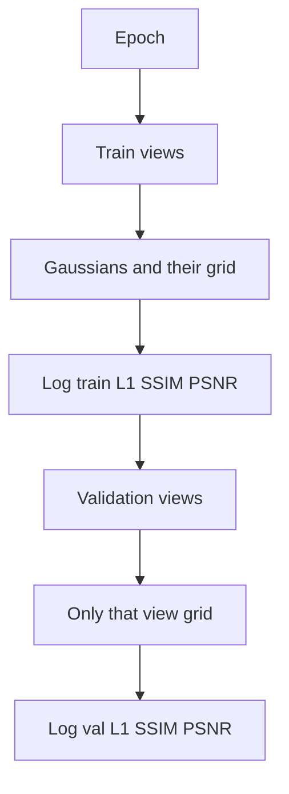
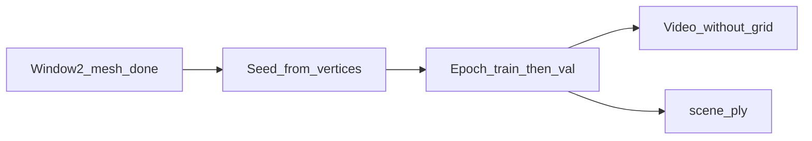

# Сплаттинг

Для отладки на записанном `.pscan` есть [Python-тренер на SlangPy](../tools/splat_training/README.md).

Телефон обучает гауссианы после того, как меш второго окна досчитан. Меш описан в [mesh.md](mesh.md), здесь он только источник начальных сплатов. Растеризация, билатеральная сетка и SSIM пишутся на Slang и собираются в SPIR-V 1.3 на этапе сборки. Компилятор в APK не кладём. CUDA-реализации не линкуем и не копируем: они задают формулы.

Опора по сетке — `BilateralGrid` и `slice` из [fused-bilagrid](/home/alex/dev/fused-bilagrid) и статья [Bilateral Guided Radiance Field Processing](https://bilarfpro.github.io/). В SSIM используются ядро 11×11 и константы `C1 = 0.01²`, `C2 = 0.03²`, как в [fused-ssim](/home/alex/dev/fused-ssim). Растеризатор использует тайлы 16×16. По принципу SnugBox и AccuTile он строит эллипс вклада и берёт тайлы между пересечениями вдоль короткой стороны ограничивающего прямоугольника. Пары сортируются на GPU по номеру тайла и глубине. Прямой проход смешивает сплаты спереди назад, пока пропускание пикселя не достигнет порога 1/255. Обратный проход использует ту же границу для каждого пикселя.

На шаг в память поднимается один кадр. Параметры гауссиан, их состояния Adam и билатеральные сетки остаются на всё обучение. Полный кадр читается с диска и отпускается до следующего.

## Когда включается обучение

Кнопка Start splatting стоит на втором окне. Она выключена, пока у объёма есть недорисованный чанк или в очереди ещё есть операция. Это тот же признак, по которому на окне виден процент сетки. Отдельный пересчёт меша перед сплаттингом не запускаем: дочитывается тот меш, который уже строится вокселем просмотра. Когда очередь пуста, кнопка включается. Кадры к этому моменту уже лежат на диске.

Нажатие открывает окно обучения и начинает ран. Второе окно при этом закрывается. Вернуться на него нельзя: сессия съёмки уже разобрана.

## Посев с меша

Берутся вершины досчитанного меша. Вершина marching cubes уже несёт положение и цвет поверхности. Нормаль — среднее нормалей треугольников, которым она принадлежит. Вершины янтарной кромки неснятого объёма в посев не входят: у них нет измеренной поверхности.

Общие вершины треугольников объединяются до применения бюджета. Цвет и нормаль усредняются по примыкающим треугольникам. Каждая уникальная вершина становится одним гауссианом.

- Центр — положение вершины.
- Цвет — цвет вершины, одна тройка RGB, без старших гармоник.
- Поворот ставит локальную ось Z вдоль нормали.
- Масштаб в касательной плоскости такой, что контур непрозрачности 1/255 доходит до трёх четвертей ребра вокселя. Соседние гауссианы чуть перекрываются и закрывают поверхность. Вдоль нормали масштаб в десять раз меньше.
- Непрозрачность на старте 0.5.

## Плотность

Посев задаёт стартовый набор. Дальше плотность ведётся как в обычном сплаттинге, по шагам Adam на train-кадрах. До шага 500 и после шага 15000 набор не меняется. Между ними каждые 100 шагов считается средний модуль градиента положения в плоскости кадра.

Перед вычислением нормы градиент умножается на `width / 2` и `height / 2` по соответствующим осям. В среднее входят кадры, в которых проекция сплата пересекает тайлы изображения. Начальный порог в этих единицах — `2e-4`, как в gsplat. Гауссиана с масштабом до одного процента диагонали сцены клонируется в том же месте. Состояние Adam у копии нулевое. Гауссиана большего масштаба делится на две. Положения берутся из неё как из нормального распределения, масштаб обеих делится на 1.6, исходная запись исчезает.

В том же проходе удаляются гауссианы с непрозрачностью ниже 0.005 и те, чей масштаб больше десятой доли диагонали сцены. Если после этого осталось бы меньше 64, такое удаление пропускается. Каждые 3000 шагов непрозрачность ограничивается сверху значением 0.01. Число мест для clone и split равно бюджету за вычетом числа сплатов, оставшихся после прунинга. После каждого прохода накопленная статистика градиентов обнуляется. График Gaussians показывает число после каждой эпохи.

Когда гауссианы записаны, удаляется всё, что эпохам не нужно. Уходит объём меша, около 1 ГБ на 8000 чанков. Останавливаются и освобождаются stella, камера и уменьшенные снимки в памяти. Исходные рабочие кадры снимаются с диска. В каталоге обучения рядом с цветом остаётся глубина в метрах. Поза и внутренние параметры кадра тоже остаются: их читает каждая эпоха. Сохранённый пользователем пакет `.pscan` не трогаем.

## Растеризация одного вида

Прямой проход проецирует гауссианы в кадр текущего размера, считает тайлы по эллипсу вклада, сортирует пары и смешивает спереди назад. У смешивания три специализации: цвет, ожидаемая глубина и обе сразу. Растеризатор делит накопленную глубину `Σ(T·α·z)` на накопленный вес `1−T`, чтобы получить ожидаемую глубину в метрах. Пиксель без сплатов получает глубину 0. Лосс глубины — средний L1 обратной глубины по пикселям, где и эталон, и оценка больше 0.05 м, с весом `extent · 0.01`. Видео и картинки валидации остаются цветом. Обратный проход начинается с последнего сплата, который внёс вклад в конкретный пиксель, и дифференцирует нормирование глубины. Градиенты суммируются в float32. Список пар живёт только на время кадра. Если видеокарта не может выделить его, шаг останавливается с текстом ошибки.

## Билатеральная сетка

У каждого кадра, включая validation, своя сетка. Форма одной сетки — `(12, L, H, W)`. По умолчанию яркость-guidance `L = 8`, высота `H = 16`, ширина `W = 16`. Двенадцать чисел клетки — аффинное преобразование 3×4. На старте в каждой клетке лежит единичная матрица: цвет проходит сетку без изменения.

Срез берёт координату пикселя `xy` в диапазоне `[0, 1]` и яркость уже отрендеренного цвета `0.299R + 0.587G + 0.114B`. По этим трём координатам из сетки трилинейно выбирается 3×4, и цвет пикселя становится `rgb' = M rgb + t`. Шаг обучения трогает только сетку текущего кадра.

К потере кадра добавляется total variation активной сетки: средний модуль разности соседних клеток по каждой из трёх осей. Вес члена малый, чтобы сетка убирала сдвиг экспозиции и не запоминала сам кадр. Чужие сетки в этот член не входят.

На кадре из train градиент среза идёт и в коэффициенты сетки, и обратно в отрендеренный цвет, то есть в гауссианы. На кадре из validation градиент обрывается на сетке и в растеризатор не проходит.

## SSIM

Прямой проход считает карту SSIM между исправленным рендером и цветом кадра. Для каждого пикселя шейдер сворачивает окно 11×11 произведением симметричных одномерных весов:

`0.00102838, 0.00759876, 0.03600077, 0.10936069, 0.21300553, 0.26601171` и далее симметрично.

За краем кадра пиксель читается как ноль. Каналы считаются отдельно. Значение потери — среднее карты, `C1 = 0.01²`, `C2 = 0.03²`.

Для метрики достаточно прямого прохода. Для обучения обратный проход свёртывает пришедший градиент тем же ядром. Частные производные карты по среднему, по дисперсии первого изображения и по ковариации хранятся на время кадра и удаляются вместе с ним.

L1 по цвету усредняется по пикселям и каналам. У потери кадра четыре слагаемых.

`L1 + 0.2 * (1 - SSIM) + λ * TV + 0.01 * extent * depthLoss`

В режиме ручных настроек L1 и SSIM используют цвет после билатеральной сетки. Длинный профиль обучает цвет гауссиан напрямую с весом глубины `0,04 * extent`. В лог отдельно пишется PSNR, равный `10 * log10(1 / MSE)` при цвете в `[0, 1]`.

В режиме ручных настроек Adam ведётся отдельно для параметров гауссиан и для коэффициентов сеток. Знаменатель шага — `sqrt(v) + 1e-15`. Моменты `β1 = 0.9`, `β2 = 0.999`. Логарифм масштаба `5e-3`, поворот `1e-3`, логит непрозрачности `5e-2` и цвет `2.5e-3` постоянны. Центр стартует с `1.6e-4` и к последнему train-шагу рана падает до 1% этого значения. Сетка стартует с `2e-3`. В первые `min(1000, N/5)` её шагов скорость растёт от 1% до полной, затем к концу рана падает до 1%. N — число шагов сетки за все эпохи, включая validation. Длина обоих расписаний берётся из числа эпох этого рана. Полный набор гиперпараметров пишется в `hyperparameters.json` рядом с `metrics.jsonl`.

## Эпоха

Кадры делятся один раз в начале рана. Validation включён по умолчанию. Доля берётся из настроек, допустимы 5, 8 и 10 процентов, по умолчанию 5. Кадры сортируются по id. В validation попадают те, чей номер в этом порядке кратен `round(100 / процент)`. Для 5 процентов шаг равен 20. Повтор того же пакета даёт тот же набор. Остальные кадры идут в train. Проход validation выполняется каждые N эпох. N задаётся в настройках, по умолчанию 5, минимум 1. Если validation выключен, все кадры идут в train. Единственный кадр тоже целиком используется для train.

Кадр validation не обновляет гауссианы. В режиме ручных настроек обновляется сетка этого кадра.

По умолчанию после разделения проверяется избыточность train-кадров. Вершины и центры треугольников измеренного меша проецируются в кадры и сверяются с глубиной. Кандидаты с худшим совпадением глубины и меньшей резкостью рассматриваются первыми. После отсева остаются хотя бы 99% покрытых точек и 95% точек с измеренным параллаксом. Для параллакса нужны два наблюдения с базой от 5 см и углом между лучами от 3°. В каждом кубе со стороной пять вокселей остаются хотя бы 92% покрытия и 75% параллакса. Допустимая потеря округляется вниз до целого числа точек, так что малые участки сохраняются полностью.

Для каждой исходной позы с подтверждённой глубиной остаётся train-кадр в пределах 35 см и 18° полного поворота камеры. Кадры без подтверждённых точек остаются в обучении. Индексы сеток и расписания Adam рассчитываются по выбранным кадрам. `run.json` хранит ID отброшенных кадров и покрытие с параллаксом до и после отсева.

В режиме ручных настроек проход train идёт по своим кадрам в порядке id. На каждом кадре тренер читает цвет с диска, рендерит гауссианы, применяет сетку, считает потерю по исправленному цвету и делает шаг Adam в гауссианы и сетку. L1, SSIM и PSNR берутся с того исправленного кадра, который вошёл в потерю, до шага. В конце прохода три числа усредняются по кадрам и пишутся как train.

Затем проход validation. Гауссианы заморожены. После рендера и первого среза сетки считается SSIM текущего кадра. По его градиенту и L1 делается шаг Adam только в сетку этого кадра. Второй срез использует обновлённые коэффициенты. С него считаются метрики и сохраняется картинка для окна метрик.

### Длинный профиль Android

В **Settings → Splatting** по умолчанию включён **Long training**. Первые 18 блоков по 256 шагов идут в половинном разрешении, следующие 6 блоков по 256 шагов идут в полном. Validation идёт в полном разрешении раз в два блока и в конце. Переход между разрешениями сохраняет параметры гауссиан и моменты Adam. Максимум 100 000 гауссиан. [Гиперпараметры основного этапа](../tools/splat_training/long-run.json)

На шаге 6 144 сохраняется `scene-006144.ply`. Затем проходят ещё три блока по 256 шагов в полном разрешении на конечных скоростях для цвета и центров. Для уточнения пороги близости поз составляют 12 см и 8°, скорости обновления масштаба и непрозрачности равны `0.002` и `0.02`. Кадры перемешиваются с фиксированным seed, обход продолжается между блоками. Цвет обучается напрямую, PSNR validation относится к самому рендеру. Метрики глубины включают MAE, RMSE и покрытие измеренных пикселей.

Чтобы сравнить отсев, откройте один и тот же сохранённый скан для каждого прогона и переключите **Filter redundant frames**. **Long training** и долю validation оставьте одинаковыми. Сравните строки validation с `gauss_step` 6 144 и 6 912 и наборы кадров в `run.json`.

## Окна

Обучение — отдельная Activity. На ней четыре графика, L1, SSIM, PSNR и число гауссиан, у каждого свои оси с подписями эпохи и метрики. Легенда различает train и validation цветом. Масштаб и сдвиг остаются внутри рамки графика. Полоса прогресса называет проход: `Epoch 3 / 100, train` или `validation`, и заполняется по кадрам этого прохода. Тот же индикатор заполняется при рендере видео. На этих графиках можно выбрать один другой готовый ран для сравнения. Его кривые рисуются второй парой цветов. Выбор этого рана снимается повторным нажатием. Пока ран идёт, из этого окна нельзя вернуться к съёмке. Кнопка назад ничего не делает. Свернуть приложение можно: обучение продолжается, а в шторке висит уведомление с номером эпохи и полосой прогресса этой эпохи. Нажатие на уведомление возвращает в окно обучения. Когда ран кончается, уведомление снимается. Кнопка Stop заканчивает ран досрочно: в папку пишутся метрики и PLY на текущих гауссианах. Остановка посреди train не записывает новый ролик; ролик прошлой validation остаётся. После Stop и после последней эпохи окно обучения закрывается, и пользователь оказывается на первом окне.

Метрики — другая Activity, список папок `splat-*`. У рана видны имя, сколько эпох записано из запланированных, последний train PSNR и последний val PSNR, либо пометка, что validation был выключен. Папка удаляется целиком, с подтверждением. Открытый ран показывает три графика, ленту `val/{id}.png` и плеер `video.mp4`. Если ролика ещё нет, на экране так и написано. Во время рана это окно открывается поверх обучения, и назад с него возвращает на обучение, не останавливая ран. Готовые раны открываются из ящика первого окна.

Графики рисует Vico.

## Настройки

В разделе Splatting по умолчанию включены validation и `Filter redundant frames`. Доля validation составляет 5, 8 или 10 процентов, по умолчанию 5. Длина видео по умолчанию 10 секунд. Выключите `Long training`, чтобы задать число эпох, бюджет, интервал validation и параметры уплотнения вручную. Настройки сохраняются на следующий запуск.

## Папка рана

Каждый запуск лежит в своей папке `splat-yyyyMMdd-HHmmss` во внешнем хранилище приложения. Обязательные результаты:

- `metrics.jsonl`. В конце прохода сохраняются эпоха, число шагов, разрешение и метрики цвета и глубины.
- `video.mp4`. Длинный профиль записывает ролик в конце рана. Ручной профиль записывает его после каждого прохода validation или в конце рана при выключенном validation.
- `scene.ply`. Сцена гауссиан.

В папке также находятся рендеры `val/{id}.png` и `run.json` с настройками рана, горизонтами Adam, ID train и validation и результатом отсева кадров.

Видео берёт короткий кусок траектории всех кадров пакета, в порядке id, а не только train. Между соседними ключами поза интерполируется: перенос линейно, поворот через slerp, шаг около 2 см или 2°. Из этого пути в ролик попадает середина. Длина задаётся в настройках, по умолчанию 10 секунд, 30 кадров в секунду. Кадр ролика — рендер гауссиан без билатеральной сетки.

PLY хранит обычный набор 3D Gaussian Splatting: центр, нормаль, цвет `f_dc`, непрозрачность, три масштаба, кватернион поворота. Коэффициентов билатеральной сетки в файле нет. Сетка выравнивает цвет только на время метрик.

